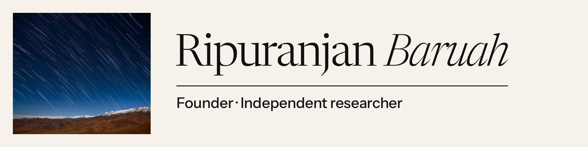

  <a href="https://ripuranjan.com">
  <picture>
    <source media="(prefers-color-scheme: dark)" srcset="assets/banner-plates-dark.png">
    <source media="(prefers-color-scheme: light)" srcset="assets/banner-plates-light.png">
    
  </picture>
  </a>

Founder of [Gambits](https://gambits.in) · independent researcher in space imaging and orbital tracking. The full record, with live figures and notes, is at **[ripuranjan.com](https://ripuranjan.com)**.

**Now and next**

- **Gambits** · launching November 2026, free during early access.
- **FERRITE** · accepted for oral presentation, ADASS XXXVI (2026). Preprint and code to follow.
- **PHOTON-3D** · code release, October 2026.
- **RADiANT** · in design.
- **Ahead** · a second venture, larger in scope. In preparation.

---

### [Gambits](https://gambits.in)

*A chess trainer that studies your own games.*

Gambits reads your games from Lichess or Chess.com, finds the mistakes you keep repeating, and builds a short daily practice around them. Your Skill Map only changes when you play real games, never from practising in the app. Every score shows the moves behind it.

Web and Android · bootstrapped, team of two.

---

### FERRITE

*Lossless image compression for space telescopes, built so one corrupted tile doesn't cost the frame.*

> **Accepted for oral presentation, ADASS XXXVI (2026)**
> *FERRITE: A Fault-Error Resilient Rice Integer Tile Encoder for Orbital Science Imaging*

Science frames from orbit are compressed before they are sent down, and a few flipped bits can make a compressed file unreadable. FERRITE splits each frame into tiles that carry their own checks, so damage is caught, marked and contained while everything else decodes exactly. Rewritten in 2026 as a C library with a written file format, it needs no floating-point unit and gives identical results on any processor.

<b>How it works</b>

 

- Each frame is cut into tiles, 64 × 64 pixels by default. Every tile picks the best of eight predictors, including new ones suited to sky background, and is coded on its own.
- Every chunk and every chunk header carries a CRC-32C check. After damage, decoding resumes at the next intact chunk.
- The image description repeats every 64 tiles, and the FITS headers are stored at both ends of the file. Whole multi-extension files are rebuilt byte for byte.
- Lost pixels are set to the FITS blank value and listed in a separate mask, so they can never pass for real data.
- In multi-read infrared exposures, each read can be predicted from the first one, only in tiles where that saves at least 10%.
- An optional error-bounded mode guarantees a maximum error per pixel. At a maximum error of 1, files shrink by about a third and noise rises by 2–3%.

<b>Measured results (raw Hubble data)</b>

 

| File | Original | fpack | FERRITE | Smaller by |
|---|---|---|---|---|
| ACS, crowded field | 34.34 MB | 16.82 MB | 14.65 MB | 12.9% |
| ACS, sparse field | 34.34 MB | 9.83 MB | 8.58 MB | 12.7% |
| ACS, mixed field | 34.34 MB | 11.76 MB | 9.95 MB | 15.4% |
| WFC3/UVIS, held out | 34.89 MB | 11.12 MB | 9.76 MB | 12.2% |
| WFC3/IR, 8 reads, held out | 17.02 MB | 12.83 MB | 7.48 MB | 41.7% |

"Held out" files were never used to tune the design. On single images, FERRITE matches JPEG-XL lossless in size and is the smallest of all codecs tested on both held-out images.

**Under damage**, on the same ACS file:

| Damage | FERRITE | fpack |
|---|---|---|
| 1 flipped bit in pixel data | 0.02% of pixels lost, all marked | 423 pixels wrong, no warning |
| Start of file destroyed (40 bytes) | Nothing lost, backup copy used | — |
| 1 flipped bit in a header or the tile index | — | Whole file rejected |

In every damage test, the output was a valid FITS file, every loss was marked, and no pixel was wrong without a mark.

**Limits.** Encoding is 3 to 11 times slower than fpack, on one core. Tested so far on five Hubble files from three instruments, with no ground-based or small-satellite data yet.

**Also in research: RADiANT** *(in design).* Separating radio interference from signal on GPUs as telescope and radar data streams in, with a 40 Gbps target, before anything is written to disk.

---

### PHOTON-3D

*The 3D shape and spin of a satellite or rocket body, recovered from a single flickering pixel.*

A ground telescope sees an object in orbit as one point of light, whose brightness changes as it tumbles. PHOTON-3D works backwards from that light curve to the object's shape and spin axis. It renders the light a candidate shape would reflect, and adjusts the shape and spin by gradient descent until the two curves match, in place of sampling methods that take hours per object.

<b>Measured results</b>

 

| Check | Shape overlap (IoU) | Spin axis error |
|---|---|---|
| Synthetic, single pass | 0.999 | 0.01° |
| Synthetic, multi pass | 0.999 | 0.06° |

On real data from the MMT survey, for an Ariane 5 upper stage: spin period within 5.0%, and a length-to-width ratio of 1.30 against the true 1.20.

---

### [Kepler-64](https://github.com/r-baruah/kepler-64)

*We gave the universe the rules of the game, and let it figure out how to play.*

A chess engine with no chess strategy written into it. It is given the rules of chess and a small set of physical laws, and learns the rest through self-play, tuning seventeen constants of its universe by gradient descent. [Live observatory](https://r-baruah.github.io/kepler-64/).

It plays weak chess. That was never the point.

---

### Record

- **ADASS XXXVI (2026).** Accepted for oral presentation: *FERRITE*.
- **Winter of Code 2025–26, IIIT Kalyani.** Selected through the proposal round; contributed to [Pyre](https://github.com/Open-Source-Chandigarh/pyre), Open Source Chandigarh (Feb–Mar 2026).
- **Hack Space 2025.** Winner, with [SENTRY](https://github.com/r-baruah/SENTRY).

### Also

- [HeapGlass](https://github.com/r-baruah/HeapGlass): watch a running C/C++ program's heap live. Leaks redden as they age, and double-frees flash instead of crashing. 1.23% overhead. Hackathon build.
- Chess: 1800 blitz on [Lichess](https://lichess.org/@/Ripu01), before a long break.
- Guitar: committed enough to own one, not enough to fix the missing E string.

---

For research, collaboration, or what comes next: **[ripuranjanbaruah@zohomail.in](mailto:ripuranjanbaruah@zohomail.in)**

[ripuranjan.com](https://ripuranjan.com) · [Notes](https://ripuranjan.com/notes/) · [Gambits](https://gambits.in) · [ORCID](https://orcid.org/0009-0000-3698-9699)

Banner photograph: Diana Juncher/ESO, CC BY 4.0.

